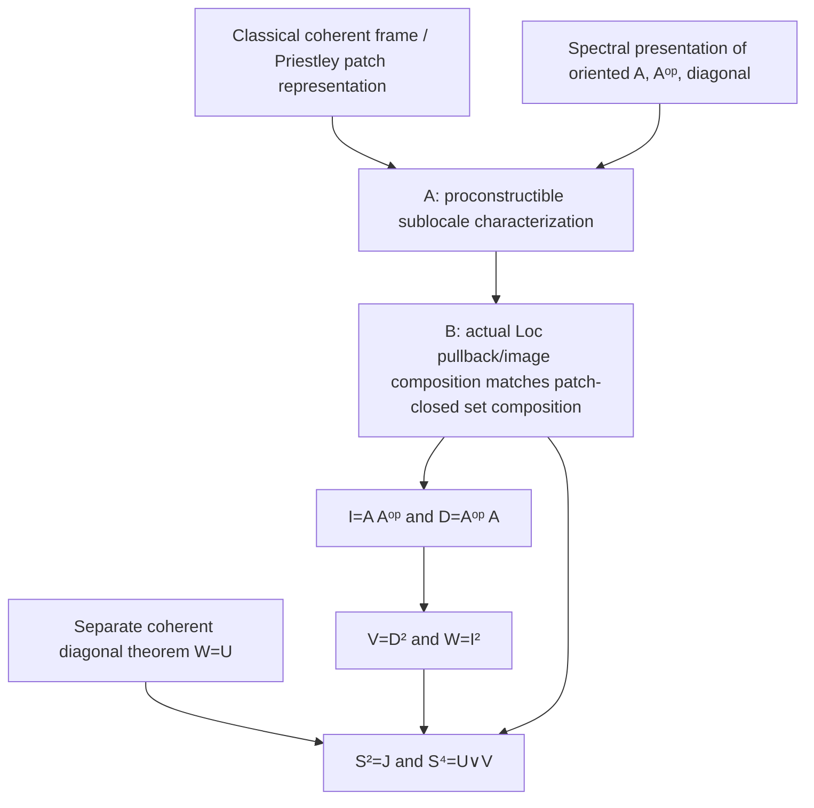
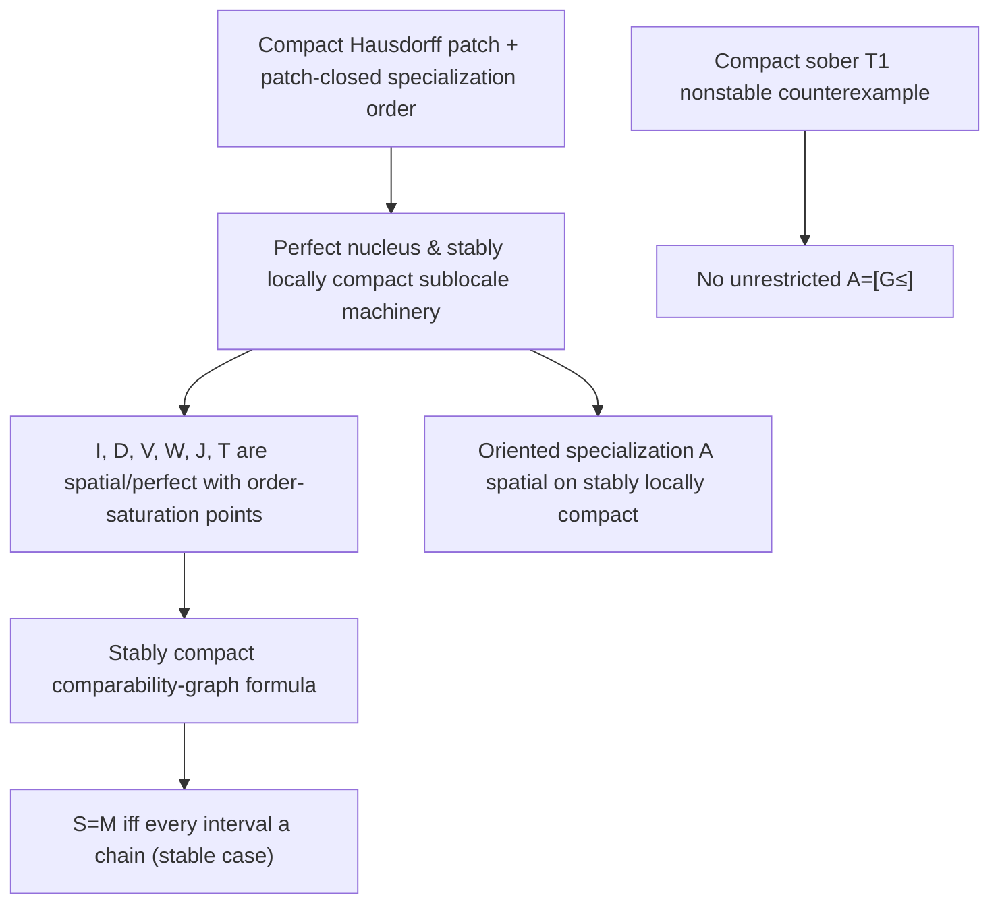
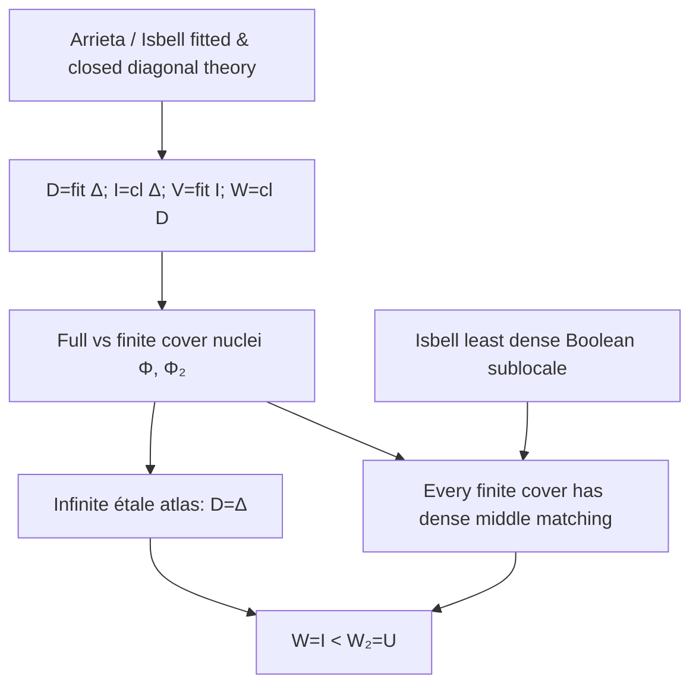
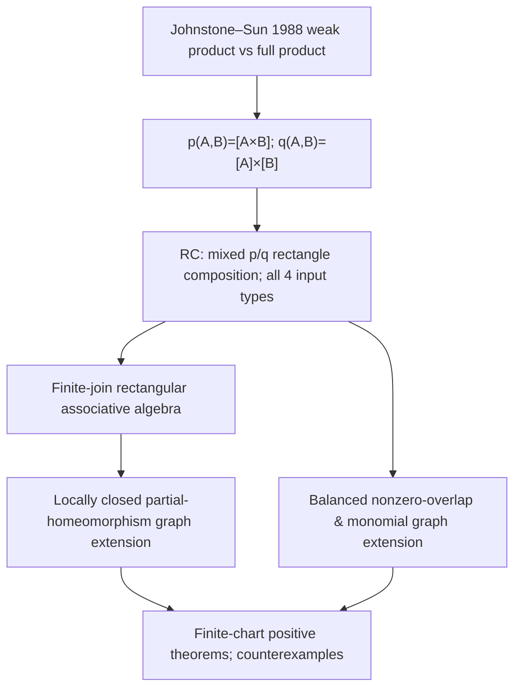
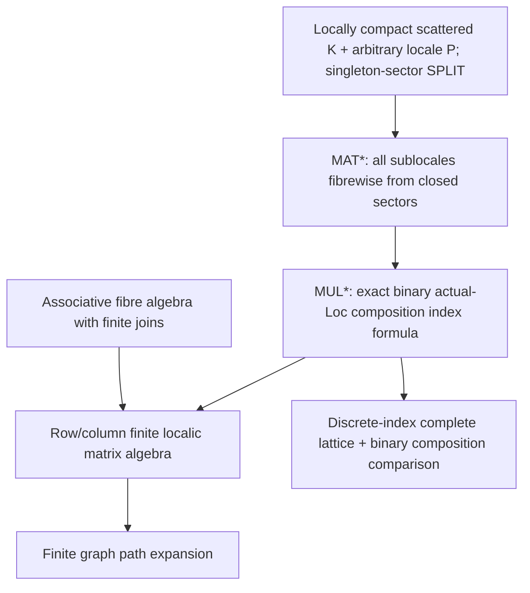
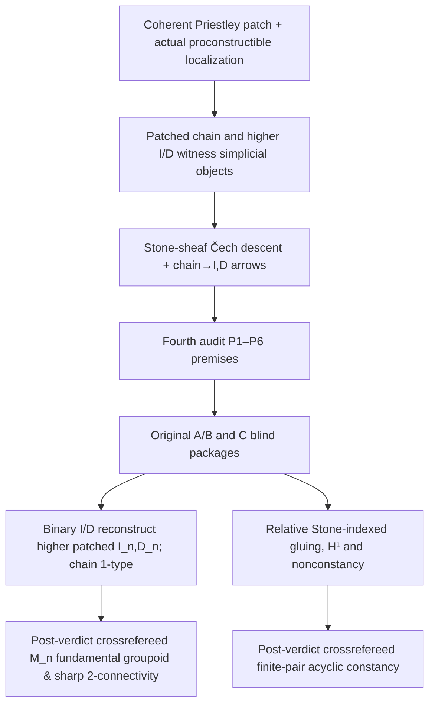

# Point-free topology — dependency atlas and audit gates

**Current dependency view:** Read alongside the [adopted proof-guided synthesis](ProjectA_ENDGAME_TWO_STUDIES_PROOF_GUIDED_ACCOUNT_2026-11-21.md). MAT*→MUL*→FINMAT* holds for **arbitrary locale P** and **locally compact scattered Hausdorff K** by a [separate focused blind check](ProjectA_MATSTAR_MULSTAR_REFEREE_RECONCILIATION_2026-11-21.md); older compact-parameter language is historical. Higher Stone-sheaf theorems retain their exact imported-premise and chosen-site restrictions. [Dated notices preserved verbatim](ProjectA_ENDGAME_HISTORICAL_STATUS_NOTICES_ARCHIVE_2026-11-21.md).
## Endgame consolidation, first pass · 21 November 2026

Companion authoritative [current theorem ledger v3.0](ProjectA_ENDGAME_THEOREM_LEDGER_CURRENT_2026-11-21.md). A proof **gate** is a statement/assumption the next result actually uses. Passing a gate does NOT certify priority, publication-readiness, or a constructive version. Use **exact localic pullbacks/images**, not ordinary point relations, unless a separately proved spatiality or spectral theorem makes that identification valid.

## 1. Main directed proof modules

### A. Coherent diagonal and graph powers

**Gate:** The [coherent canonical proof](ProjectA_coherent_composition_canonical_proof_2026-11-08.md) explicitly **imports** W=U. Do not say it follows from Theorem B in isolation. All its words are **finite** and source locales **coherent**; arbitrary joins, arbitrary noncoherent locales, and all relation sublocales remain outside. The category equivalence with Stone **closed** relations is an **internally derived endgame corollary** (not original blind claim), using this actual Loc-image gate and the classical compact Hausdorff closed relation calculus. Related [exact source comparison](ProjectA_ENDGAME_EXACT_COMPARISON_PATCH_AND_PQ_2026-11-21.md).

### B. Stably compact hierarchy and specialization

Source order and scope: [J/T canonical](ProjectA_J_T_COMPARABILITY_GRAPH_STABLY_COMPACT_CANONICAL_2026-11-17.md), [SC+](ProjectA_SCplus_CANONICAL_2026-11-15.md), [A-SC](ProjectA_ASC_CANONICAL_2026-11-15.md), [LC-A negative](ProjectA_LCA_COUNTEREXAMPLE_CANONICAL_2026-11-15.md). **Classical point set claims do not yield localic subobject equalities** without the perfect/spatiality argument. “Stably locally compact” ≠ “locally compact”; LC-A is specifically an example of their difference. The J/T **new eight-vertex sharpness** is post-referee addendum, not covered by original blind packet.

### C. Fitting/closure and counterexamples

[Q/Q′ canonical](ProjectA_Q_DENSE_RATIONAL_BRIDGE_CANONICAL_2026-11-14.md) distinguishes (i) all-cover descent, (ii) finite-cover dense matching, (iii) the nonzero pointless Boolean witness B(J), (iv) ambient **closed hull** saturation. Do not claim arbitrary Δ-cover meets equal finite-cover meets, or infer their hull inequality merely from pointwise data. Its post-referee **quasi-Polish** corollary uses de Brecht 2013. Previous Q-open entries are **false historical statuses**.

[Finite-rank V proof](A-Vfin-negative-consolidated-proof-2026-10-23.md) has TWO separate gates: (a) exact \(\omega\)-rank bar from iterated K-fans, (b) two-generic-point or cofinite-sheet transfer proving **strictness of fitted sublocales**. Unbounded individual ranks/noncofinality alone is insufficient. The T1 version has no sobriety claim.

### D. Compact Hausdorff rectangle → charts → balanced graphs

**Gate RC is required:** [rectangular canonical](ProjectA_CLIQUE_RECTANGULAR_CALCULUS_POSTREFEREE_CANONICAL_2026-11-20.md), external audit repaired candidate; p/q weak/full product antecedent **L** [Johnstone–Sun comparison](ProjectA_ENDGAME_JOHNSTONE_SUN_WEAK_PRODUCTS_PRIMARY_SOURCE_2026-11-21.md). In graph extensions [postreferee canonical](ProjectA_GRAPH_EXTENSIONS_POSTREFEREE_CANONICAL_2026-11-21.md), composition with charts uses locally closed restriction LC and partial graph PH; associativity of RHR is the nontrivial balanced overlap equivalence. There is an explicit graph-probe **nonassociator** despite proper open surjection, so do not infer from openness/properness alone.

[Balanced witness reconciliation](ProjectA_BALANCED_WITNESS_SCATTERED_MATRIX_POSTREFEREE_RECONCILIATION_2026-11-21.md) accepts specified G/T/O statements **conditional on RC**. The abstract wreath-product group identification needs **nonempty P** for faithfulness; group multiplication itself includes empty cases. Most importantly: the complete-lattice TWIST transport is accepted, whereas its *unqualified broad partial-graph associativity* is **not proved**. No implication from “lattice transport” to “preserves actual pullback/image” without a common ambient-space check.

### E. Scattered matrices

**Current main source:** [arbitrary-parameter MAT*/MUL*/FINMAT* canonical](ProjectA_MATSTAR_MULSTAR_POSTREFEREE_CANONICAL_2026-11-21.md) and [separate blind referee reconciliation](ProjectA_MATSTAR_MULSTAR_REFEREE_RECONCILIATION_2026-11-21.md), superseding the original compact-Hausdorff parameter restriction of the [older matrix reconciliation](ProjectA_BALANCED_WITNESS_SCATTERED_MATRIX_POSTREFEREE_RECONCILIATION_2026-11-21.md) and [older matrix note](ProjectA_SCATTERED_INDEX_LOCALLY_FINITE_LOCALIC_RELATION_MATRICES_2026-11-21.md). **The crucial image proof**: form actual composability sublocale Q in a triple product, split Q into the MATn **closed sectors**, then take arbitrary-join-preserving localic image and reconstruct by SPLIT. It is generally **invalid** to distribute localic pullback/meet over an infinite join of entries. Arbitrary matrix binary multiplication exists but is **not associative** merely by this formula. FINMAT uses *finite* supports.

**Separate provenance:** the **arbitrary-parameter locally compact scattered MAT*/MUL*/FINMAT* extension has now received its own focused blind technical audit**. Earlier one-sided matrix, finite-flank and discrete-index comparisons arose in earlier referee addenda; arbitrary-subspace index heredity and indexed image formulas are **post-new-audit addenda** and should not inherit the main theorem's independent review status.

### F. Generic fibre, four-step effectivity, Scott-continuity

- [Generic-fibre localization](ProjectA_GENERIC_FIBRE_COMPOSITION_POSTREFEREE_CANONICAL_2026-11-19.md) is an abstract **E** theorem conditional on explicit F_i/U_i cutoffs and cutoff rigidity.
- [Four-step short proof](ProjectA_FourStep_Short_Proof_Consolidated_2026-11-19.md) is a **qualified E** after a necessary special patch-fibre repair, uses the fixed finite-fence coordinate geometry. [Cutoff foundations](ProjectA_FourStep_Fibre_Cutoff_Foundations_CANONICAL_2026-11-20.md) assembles the kernel pair assuming the generic-square inclusion. It is **fixed-bracketing**, not full associativity.
- [Unrestricted L*](ProjectA_Lstar_canonical_corrected_proof_2026-11-08.md) is **E** after the false principal-downset assertion in the initial proof was corrected; uses standard proper map pullback stability and nonempty directed joins. This result has its own technical spine, not derivable from scattered matrices.

> **21 NOV 2026 — LOCAL COLD READ OF HIGHER MEET-HULL COMPARISON:** [technical six-point and connectivity verification note](PointFree_ENDGAME_BINARY_MEET_CONNECTIVITY_COLD_READ_2026-11-21.md) confirms the P/Q fixed patched I,D but different S²/point chain 2-types, shows M is a cone, checks the witness-independent groupoid inverse, and explicitly isolates the Stone Čech-realization and connectivity-lemma imports. This is **internal conditional verification**; cross-referee status remains unchanged.

### G. Dowker and classifying anima

Critical sites: [chain-hulls canonical](PointFree_coherent_chain_hulls_CANONICAL_2026-11-10.md), [sheaf Čech canonical](PointFree_nonconstant_sheaf_Cech_CANONICAL_2026-11-10.md), [binary meet-hull canonical](PointFree_binary_meet_hull_CANONICAL_2026-11-11.md), [relative-gluing canonical](PointFree_relative_gluing_twisted_CANONICAL_2026-11-11.md), [fourth-audit final reconciliation](PointFree_audit4_FINAL_RECONCILIATION_2026-11-11.md).

**Boundaries:**
1. Every patched statement is in a **chosen Stone-sheaf ∞-topos** \(\mathscr H_\kappa\); site-size independence, hypercomplete and intrinsic locale-shape claims were not proven.
2. The binary pair (I,D) with patch topology reconstructs **higher I_n,D_n as patched spaces** and chain **1-type**, not full higher chain homotopy. Binary preserving **maps** may fail M₂; binary *isomorphisms* suffice for the C05 groupoid result.
3. “Chain→M 2-connective” means π₀,π₁ **isomorphisms** and π₂ **epimorphism**; it need not be π₂-injective or 2-type equivalence.
4. The original A/B/C fourth-audit claims are **E conditional on earlier P1–P6**, but the meet-hull groupoid/2-connectivity and acyclic-constancy theorems are **X** (post-verdict cross-checked). The “all nontrivial groups” twisted H¹ extension is **I** (post-final nonblind check).
5. [Classifying-anima identification](PointFree_classifying_anima_identification_2026-11-11.md) is a definition-level match to **Haine's published coherent-point construction**, internal and not independently audited. [Crosscut ladders](PointFree_crosscut_connectivity_ladder_2026-11-11.md) are internal with classical Björner antecedents; don't use them as independently certified external results.

## 2. Status/priority boundary

The *source* literature crosswalk is [endgame source ledger](ProjectA_ENDGAME_LITERATURE_CROSSWALK_2026-11-21.md), with specialized branches for [composition](ProjectA_ENDGAME_COMPOSITION_LITERATURE_DEEP_DIVE_2026-11-21.md), [separation](ProjectA_ENDGAME_SEPARATION_PRIMARY_SOURCE_CROSSWALK_2026-11-21.md), [weak products](ProjectA_ENDGAME_JOHNSTONE_SUN_WEAK_PRODUCTS_PRIMARY_SOURCE_2026-11-21.md) and [hull/ranks](ProjectA_ENDGAME_COUNTEREXAMPLE_RANK_LITERATURE_FOCUSED_REVIEW_2026-11-21.md).

**Keep three kinds of significance distinct:** a known theorem in different notation; an exact localic realization/translation with additional proof; and a potentially new calculation/counterexample. No conclusion here establishes publication novelty. Extensive model-led blind audits are not proof formalization or human peer review. Final selected claims require author-led proof check and bibliography verification before submission.

## 3. Final targeted verification queue

**Priority 1:** Audit the present v3 ledger's status markings against the original blind reports and corrected canonicals. A blanket “externally checked” label on a file can conceal additional internal material. Confirm RC, coherent W=U, MAT/MUL provenance, and fourth-audit P1–P6.

**Priority 2:** Produce a curated source list: original Cameron–Kumar; Arrieta/Isbell; Johnstone–Sun; Townsend/CHLoc; Hofmann–Nora; Jakl–Suarez; de Brecht; Dowker–Brun–Salbu/Haine. Exact results linked already in literature notes.

**Priority 3 — COMPLETED in Session 11:** The [adopted two-study proof-guided synthesis](ProjectA_ENDGAME_TWO_STUDIES_PROOF_GUIDED_ACCOUNT_2026-11-21.md) now uses five concrete examples and carries explicit proof/status gates. Remaining work is review of that account against the ledger and a final freeze of truly unresolved frontiers.

**Explicitly deferred:** broad TWIST, possible extensions of MAT*/MUL* to index classes beyond the now-audited locally compact scattered case, complete rank classification, arbitrary-Loc associativity criteria, all-site intrinsic homotopy/shape, ambitious generalizations of finite-fence four-step generation.
